  

  

I'm a **freelance software engineer** with **8+ years of experience** building software applications, intelligent automation solutions, backend systems, and data-driven products.

My work spans full-stack development, custom software engineering, Generative AI, machine learning, API integration, cloud applications, and data engineering.

I focus on turning complex technical requirements into reliable, maintainable, and scalable solutions that solve real business problems.

- AI Agents, LLM Integration, RAG & Workflow Automation
- Backend Engineering with ASP.NET Core, .NET & Python
- Full-Stack Development with React, Next.js & Node.js
- Cross-Platform Mobile Application Development
- Data Engineering, ETL/ELT & Machine Learning
- Cloud Applications, DevOps & CI/CD
- Third-Party APIs & System Integration
- Clean Code, Performance & Reliability

## Featured projects

<table>
<tr><td width="50%" valign="top">
AI / Automation
<h3>AI Agents &amp; Workflow Automation</h3>
Intelligent workflows combining LLMs, APIs, and business process automation.

<code>Python</code> &nbsp; <code>FastAPI</code> &nbsp; <code>LLMs</code> &nbsp; <code>REST APIs</code>
</td><td width="50%" valign="top">
Generative AI / Retrieval
<h3>RAG Knowledge Assistant</h3>
Knowledge retrieval workflows using embeddings, vector search, and semantic retrieval.

<code>Python</code> &nbsp; <code>RAG</code> &nbsp; <code>Embeddings</code> &nbsp; <code>Vector Search</code>
</td></tr>
<tr><td width="50%" valign="top">
Web / SaaS
<h3>Full-Stack SaaS Applications</h3>
Responsive web applications with scalable APIs and database integrations.

<code>React</code> &nbsp; <code>Next.js</code> &nbsp; <code>Node.js</code> &nbsp; <code>TypeScript</code>
</td><td width="50%" valign="top">
Data / Analytics
<h3>Data Engineering &amp; Predictive Analytics</h3>
Data processing workflows and predictive analytics solutions.

<code>Python</code> &nbsp; <code>SQL</code> &nbsp; <code>Scala</code> &nbsp; <code>Hadoop</code> &nbsp; <code>Power BI</code>
</td></tr>
</table>

## Engineering focus

**AI engineering.** LLM applications, AI agents, RAG systems, vector search, and workflow automation.

**Software engineering.** Backend APIs, full-stack applications, SaaS development, system integration, and mobile development.

**Data engineering.** ETL/ELT pipelines, data processing, predictive analytics, data quality, and database optimization.

## Technologies

<table>
<tr><td><strong>Programming languages</strong></td><td> <code>Python</code> · <code>C#</code> · <code>JavaScript</code> · <code>TypeScript</code> · <code>Java</code> · <code>Scala</code> · <code>Ruby</code> · <code>SQL</code> · <code>T-SQL</code></td></tr>
<tr><td><strong>Backend development &amp; APIs</strong></td><td> <code>ASP.NET Core</code> · <code>.NET</code> · <code>Entity Framework Core</code> · <code>FastAPI</code> · <code>Flask</code> · <code>Django REST Framework</code> · <code>Node.js</code> · <code>NestJS</code> · <code>Express</code> · <code>Ruby on Rails</code> · <code>REST APIs</code> · <code>GraphQL</code></td></tr>
<tr><td><strong>Frontend &amp; mobile</strong></td><td> <code>React</code> · <code>Next.js</code> · <code>Angular</code> · <code>MERN Stack</code> · <code>MEAN Stack</code> · <code>TypeScript</code> · <code>Redux</code> · <code>Bootstrap</code> · <code>Tailwind CSS</code> · <code>React Native</code> · <code>Expo</code> · <code>Flutter</code> · <code>Dart</code> · <code>Firebase</code> · <code>Responsive UI/UX</code></td></tr>
<tr><td><strong>AI, machine learning &amp; Generative AI</strong></td><td>    OpenAI API and LLM Integration · Prompt Engineering and Evaluation · Retrieval-Augmented Generation (RAG) · Embeddings and Vector Search · LangChain and LlamaIndex · Tool Calling and AI Workflow Automation · PyTorch and scikit-learn · Model Evaluation and Classification</td></tr>
<tr><td><strong>Data engineering &amp; analytics</strong></td><td><code>ETL/ELT</code> · <code>Data Pipelines</code> · <code>Batch Processing</code> · <code>Streaming Concepts</code> · <code>Data Modeling</code> · <code>Data Validation</code> · <code>Data Quality</code> · <code>Apache Spark</code> · <code>Hadoop</code> · <code>pandas</code> · <code>NumPy</code> · <code>Kafka</code> · <code>Power BI</code></td></tr>
<tr><td><strong>Databases &amp; storage</strong></td><td> <code>PostgreSQL</code> · <code>SQL Server</code> · <code>MySQL</code> · <code>MongoDB</code> · <code>DB2</code> · <code>Redis</code> · <code>Cosmos DB</code> · <code>Supabase</code> · <code>Azure Blob Storage</code> · <code>pgvector</code></td></tr>
<tr><td><strong>Cloud, DevOps &amp; tools</strong></td><td> <code>Microsoft Azure</code> · <code>AWS</code> · <code>GCP</code> · <code>Docker</code> · <code>Kubernetes</code> · <code>Azure DevOps</code> · <code>GitHub Actions</code> · <code>CI/CD</code> · <code>Linux</code> · <code>Git</code> · <code>API Testing</code> · <code>Logging</code> · <code>Monitoring</code></td></tr>
</table>

## Experience

### Senior Software Engineer

**AS-P · Remote** · June 2025 – Present

- Backend services and API development
- AI-powered API integration
- LLM evaluation workflows
- Data pipelines and system integration
- Reliability and error-handling improvements
- CI/CD and deployment workflows

### Senior Software Engineer

**TheAMLab · Remote** · June 2022 – May 2025

- React and Next.js applications
- Full-stack and MERN development
- React Native and Expo
- Backend API integration
- Database integration
- Testing and performance improvements

### Generative AI Engineer

**Orthogonal · Remote** · February 2019 – May 2022

- Python and FastAPI
- LLM integration
- RAG and embedding workflows
- Vector search
- Prompt and model evaluation
- Docker and CI/CD

### Software Engineer, Machine Learning

**Walmart · Remote** · May 2017 – January 2019

- Predictive failure-detection models
- Python and Scala data workflows
- DB2 and Hadoop
- C#/.NET services
- SQL Server procedures
- Power BI reporting

## Services

### AI Agents & Business Automation

Build intelligent workflows that reduce repetitive tasks and connect business systems.

AI agents and tool calling · LLM integrations · Business process automation · AI assistants and knowledge bots · Workflow automation · API-based automation

### Generative AI & RAG Solutions

Develop AI applications that retrieve relevant information from documents and business data.

Retrieval-Augmented Generation · Embeddings and vector search · Document processing · Prompt engineering and evaluation · AI-powered applications · Knowledge retrieval systems

### Custom Software & Web Development

Create modern applications tailored to business requirements.

Full-stack web applications · React and Next.js development · Node.js and ASP.NET Core · SaaS product development · Custom business software · Application improvements

### Backend & API Development

Build reliable backend systems and integrations for web, mobile, and enterprise applications.

REST API development · .NET and Python backends · Third-party API integration · Authentication and validation · Database design · Backend performance optimization

### Mobile App Development

Develop cross-platform mobile applications connected to modern backend services.

React Native applications · Expo-based development · Flutter applications · Mobile API integration · Android and iOS solutions · Mobile performance improvements

### Data Engineering & Machine Learning

Build data pipelines and analytical solutions that turn raw information into useful insights.

ETL/ELT pipeline development · Data transformation and validation · Predictive machine learning · Data quality and reconciliation · Data processing workflows · Analytics and reporting

### Cloud & DevOps

Improve deployment reliability and streamline software delivery.

Docker containerization · CI/CD pipeline setup · Cloud application deployment · Logging and monitoring · Deployment troubleshooting · Development workflow improvements

### System & Platform Integration

Connect applications, services, and databases to create dependable workflows.

Third-party integrations · REST API connectivity · Data synchronization · Legacy system integration · Cross-platform workflows · Application interoperability

### Database Development & Optimization

Design and improve database solutions for application performance and reliability.

SQL database development · Relational database design · Query optimization · Data modeling · Database integration · Data validation

### Software Testing & Maintenance

Improve application quality, stability, and long-term maintainability.

API testing · Unit testing · Bug fixing and troubleshooting · Performance improvements · Error handling and logging · Code quality improvements

## Education

**Bachelor of Science in Computer Science (BSCS)**  
University of the Punjab · Lahore, Pakistan · 2018

## Let's work together

I'm open to freelance projects, remote opportunities, and collaborations involving software engineering, AI automation, full-stack development, API integration, and data engineering.

  

### Building Reliable Software. Creating Intelligent Solutions. Delivering Real Impact.

